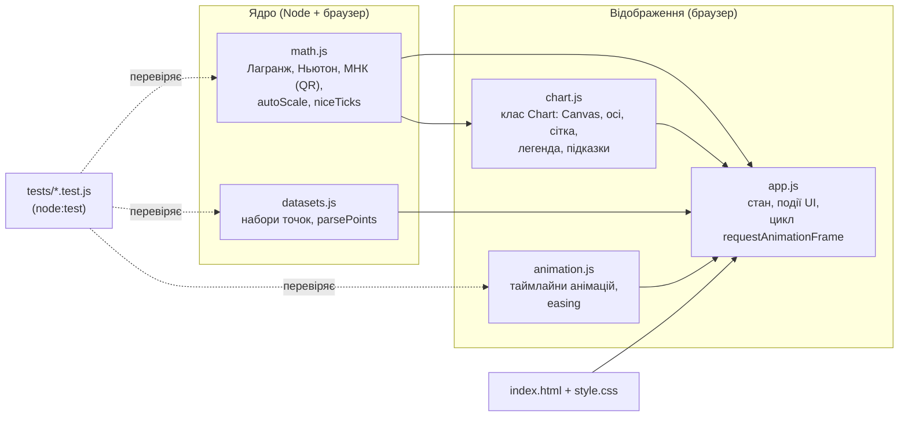
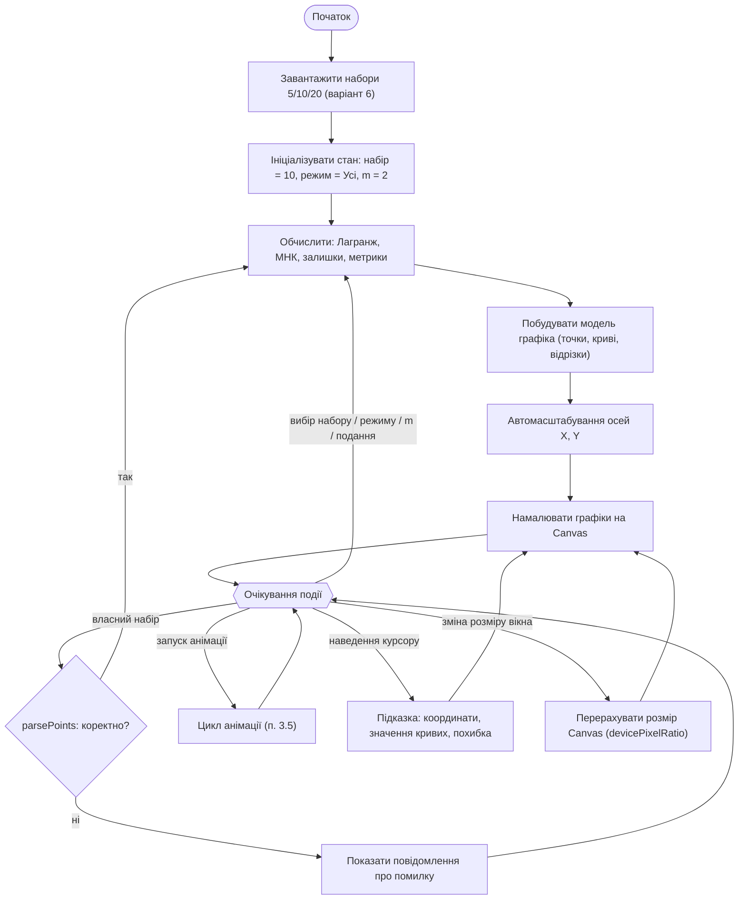
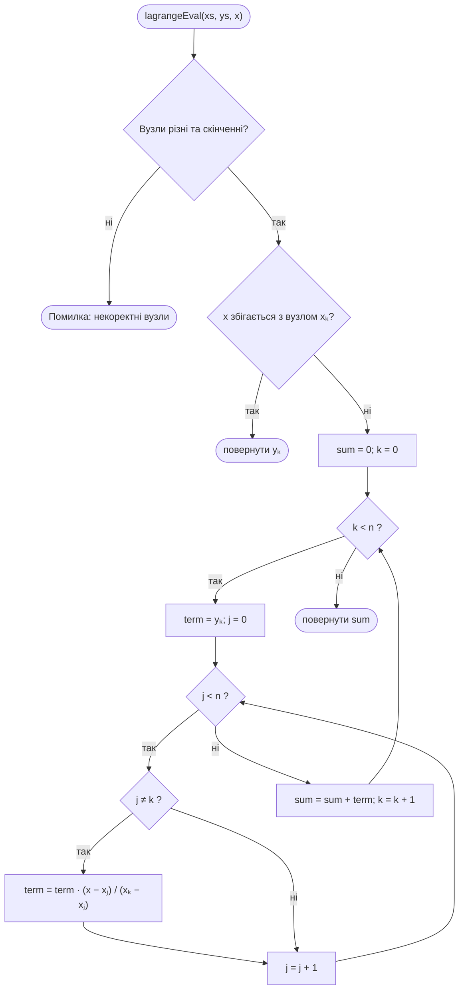
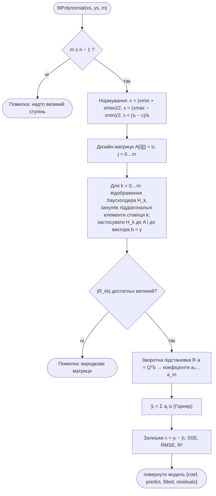
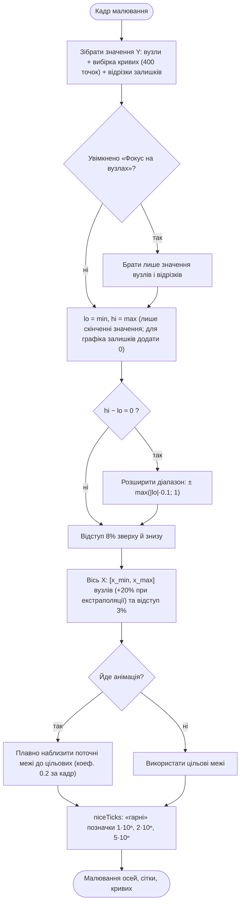
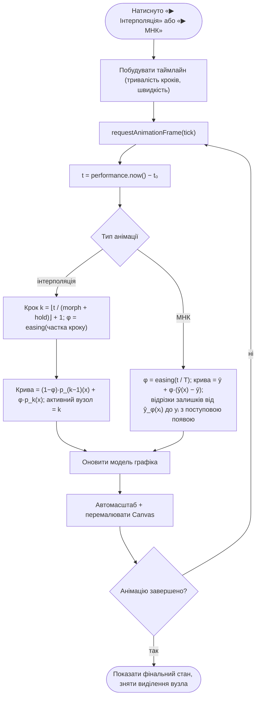

# 3. Проєктування логіки

Діаграми написано у форматі Mermaid (GitHub відображає їх безпосередньо). PNG-версії для звіту
генеруються скриптом `tools/build-diagrams.js` (джерела — коментарі `<!-- diagram: ... -->` перед блоками).

## 3.1. Архітектура застосунку

Застосунок складається з чотирьох модулів без залежностей. Математичне ядро не знає про DOM і
тестується в Node; відображення знає лише про «модель» (точки, криві, відрізки).

<!-- diagram: architecture -->

## 3.2. Блок-схема головного сценарію

<!-- diagram: flow-main -->

## 3.3. Алгоритм інтерполяції Лагранжа (з контролем Ньютона)

<!-- diagram: flow-lagrange -->

Контроль: форма Ньютона. Таблиця поділених різниць `f[xᵢ…xᵢ₊ⱼ]` будується функцією
`dividedDifferences`, значення обчислюється схемою Горнера `newtonEval`; тести перевіряють, що обидві
форми дають один і той самий поліном (одиничний за єдиністю).

## 3.4. Алгоритм МНК через QR-розклад

<!-- diagram: flow-mnk -->

## 3.5. Автомасштабування осей

<!-- diagram: flow-autoscale -->

## 3.6. Цикл анімації

<!-- diagram: flow-anim -->

## 3.7. Таблиці ідентифікаторів

### 3.7.1. Змінні (стан та ключові локальні)

| Ідентифікатор | Модуль | Тип | Призначення |
|---|---|---|---|
| `xs`, `ys` | math.js | `number[]` | Вузли та значення функції |
| `n` | math.js | `number` | Кількість вузлів |
| `m` | math.js, app.js | `number` | Ступінь полінома МНК (2, 3, 4) |
| `center`, `scale` | math.js | `number` | Параметри нормування `t = (x − center)/scale` |
| `coef` | math.js | `number[]` | Коефіцієнти МНК-полінома в змінній `t` |
| `fitted`, `residuals` | math.js | `number[]` | Розрахункові значення `ŷᵢ` та залишки `rᵢ` |
| `A`, `R`, `qtb` | math.js | `number[][]`, `number[]` | Дизайн-матриця, верхньотрикутна матриця QR, вектор `Qᵀb` |
| `table`, `coefs` | math.js | `number[][]`, `number[]` | Таблиця поділених різниць та коефіцієнти Ньютона |
| `state.setKey` | app.js | `'5' \| '10' \| '20' \| 'custom'` | Поточний набір точок |
| `state.mode` | app.js | `'interp' \| 'mnk' \| 'all'` | Режим відображення кривих |
| `state.view` | app.js | `'single' \| 'compare'` | Один набір чи порівняння 5·10·20 |
| `state.degree` | app.js | `number` | Обраний ступінь `m` |
| `state.extrap` | app.js | `boolean` | Показувати екстраполяцію ±20 % |
| `state.focus` | app.js | `boolean` | Автомасштаб лише за вузлами |
| `state.anim` | app.js | `object \| null` | Активна анімація (тип, час старту, швидкість) |
| `view` | chart.js | `{xmin,xmax,ymin,ymax}` | Поточні межі осей (результат автомасштабу) |
| `target` | chart.js | `{xmin,xmax,ymin,ymax}` | Цільові межі осей |
| `hover` | chart.js | `object \| null` | Позиція курсору та найближчий вузол |
| `TREND` | datasets.js | `{a, b}` | Опорна лінія `y = a + b·x`, за якою згенеровано точки 6…20 |

### 3.7.2. Функції

| Функція | Модуль | Призначення |
|---|---|---|
| `lagrangeBasis(xs, k, x)` | math.js | Базисний многочлен `Lₖ(x)` |
| `lagrangeEval(xs, ys, x)` | math.js | Значення полінома Лагранжа |
| `dividedDifferences(xs, ys)` | math.js | Таблиця поділених різниць та коефіцієнти Ньютона |
| `newtonEval(xs, coefs, x)` | math.js | Значення полінома Ньютона (Горнер) |
| `designMatrix(ts, m)` | math.js | Побудова матриці Вандермонда `tᵢʲ` |
| `solveLeastSquares(A, b)` | math.js | Розв'язок задачі найменших квадратів QR-розкладом Хаусхолдера |
| `fitPolynomial(xs, ys, m, w)` | math.js | МНК-апроксимація: модель із `predict`, `fitted`, `residuals` |
| `metrics(ys, fitted)` | math.js | `sse`, `rmse`, `mae`, `maxAbs`, `r2` |
| `autoScale(values, opts)` | math.js | Межі осі за min/max із відступом |
| `niceTicks(min, max, target)` | math.js | «Гарні» позначки осі |
| `sampleFunction(fn, a, b, n)` | math.js | Вибірка кривої у `n` точках |
| `parsePoints(text)` | datasets.js | Розбір користувацького набору з тексту |
| `Chart.draw()` | chart.js | Повне перемалювання: осі, сітка, шари, легенда, підказка |
| `Chart.computeTarget()` | chart.js | Автомасштабування (цільові межі осей) |
| `interpFrame(sets, tMs, opts)` | animation.js | Стан кадру анімації інтерполяції |
| `mnkFrame(fit, tMs, opts)` | animation.js | Стан кадру анімації МНК |
| `App.render()` | app.js | Побудова моделей та оновлення всіх графіків і таблиць |

### 3.7.3. Об'єкти та класи

| Об'єкт | Призначення |
|---|---|
| `LabMath` | Простір імен математичного ядра (UMD: `window.LabMath` / `module.exports`) |
| `LabData` | Набори даних варіанта 6 і парсер |
| `LabAnim` | Допоміжні функції анімації |
| `Chart` | Клас графіка на Canvas (модель → пікселі) |
| `model` | Опис шарів графіка: `points`, `curves`, `segments`, `shade`, `zeroLine` |
| `App` | Контролер: стан, події, цикл `requestAnimationFrame` |
