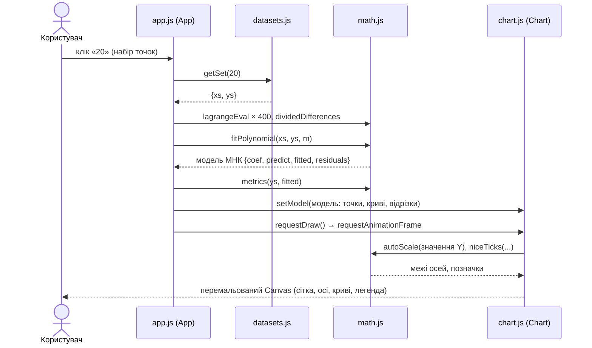
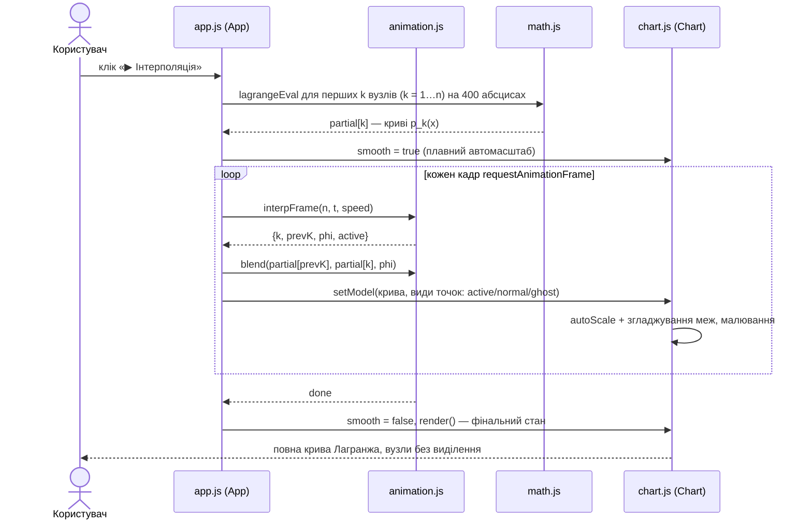
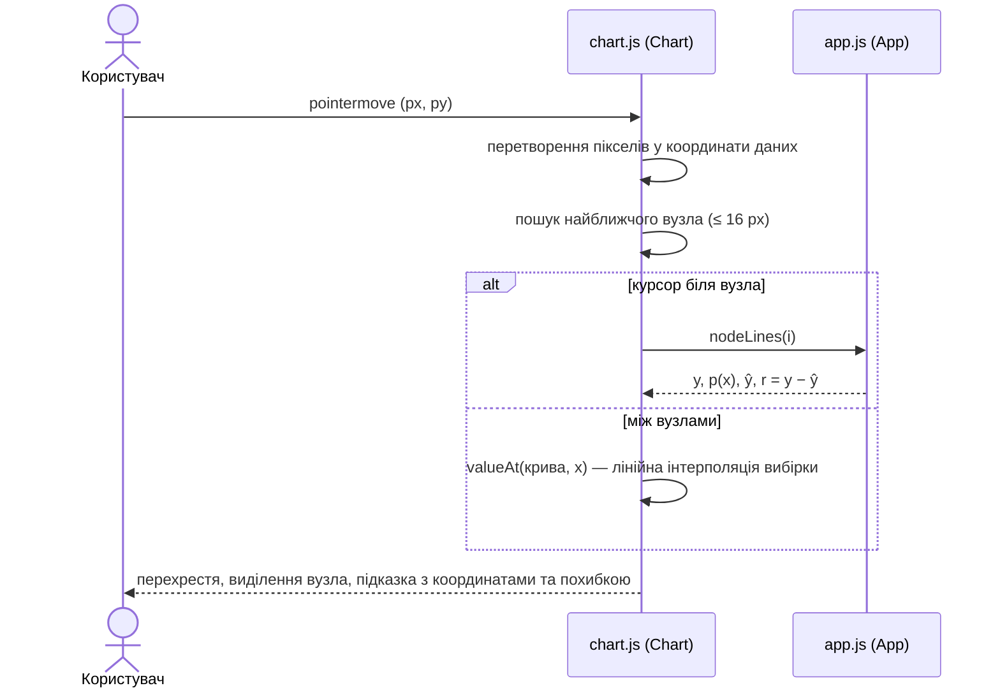

# 4. Моделювання взаємодії компонентів

Діаграми послідовності описують, як модулі взаємодіють при ключових сценаріях. Архітектурну
(компонентну) діаграму див. у `docs/03-design.md`, п. 3.1.

## 4.1. Вибір набору точок і побудова графіків

<!-- diagram: seq-select -->

## 4.2. Анімація інтерполяції

<!-- diagram: seq-anim -->

## 4.3. Підказка при наведенні

<!-- diagram: seq-hover -->

